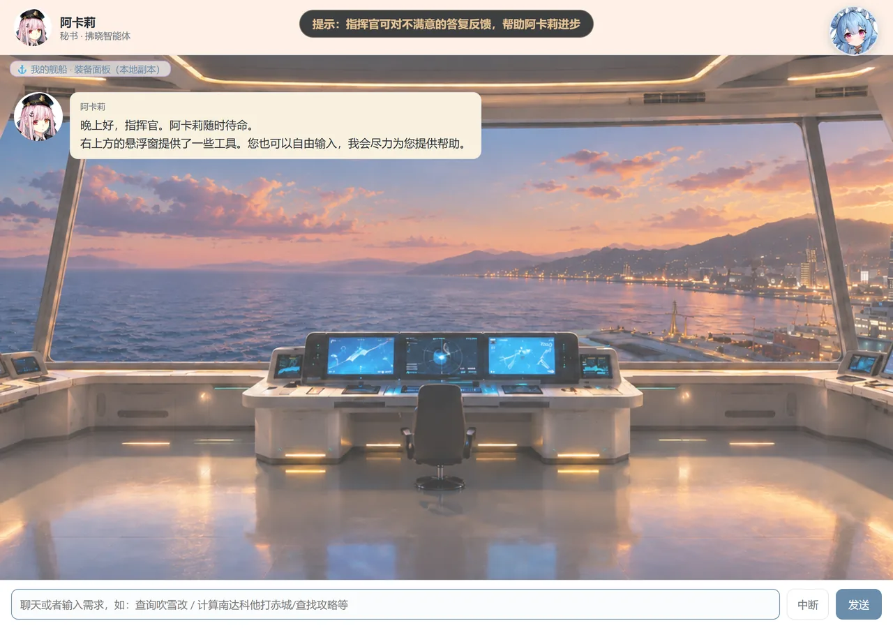
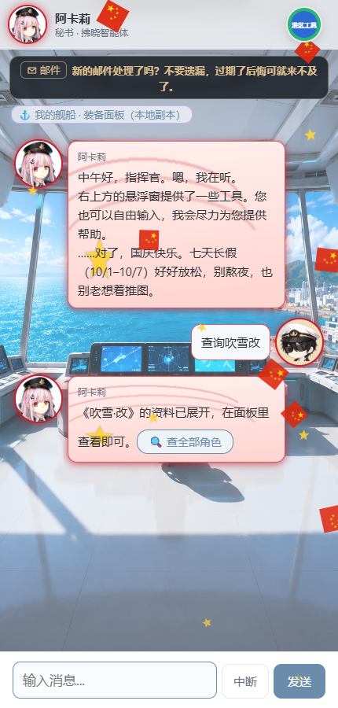
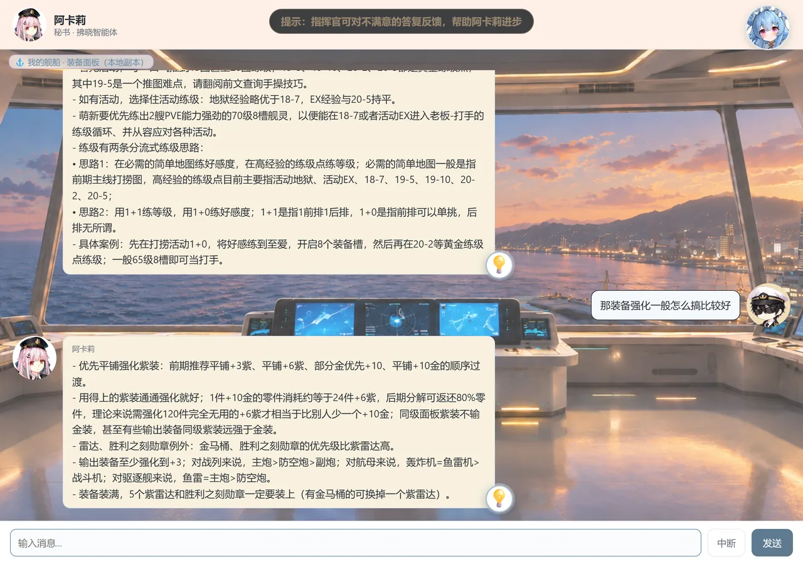
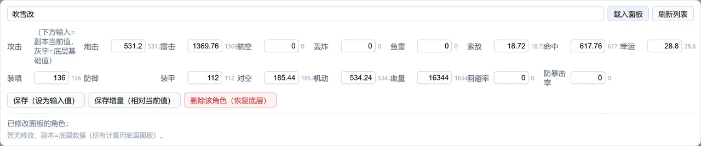
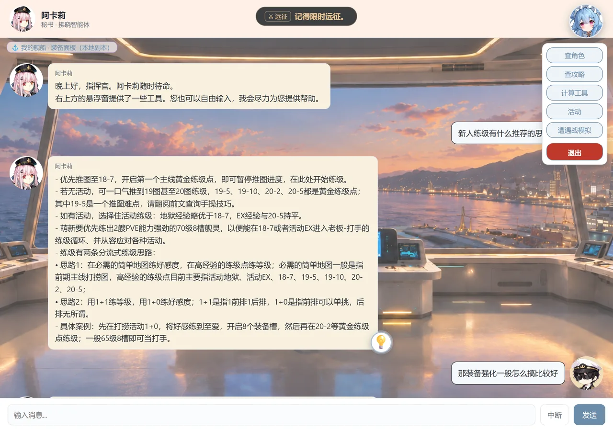

# 拂晓智能小秘书 · 使用说明手册

> 阿卡莉——你的拂晓（拂晓胜利之刻）专用小秘书。
> 本手册面向使用者，图文讲解**进入主界面之后**的常用操作。

---

## 一、主界面导览

打开服务网址进入主界面后，就是和阿卡莉的对话界面：上方是标题栏与温馨提示，中间是聊天区，底部是输入框。

| 位置 | 作用 |
|---|---|
| 顶部横幅 | 滚动显示温馨提示 / 活动事务提醒 |
| 右上角「港区工具」悬浮球 | 打开工具菜单（查角色 / 查攻略 / 计算工具 等） |
| 左上角「⚓ 我的舰船 · 装备面板」 | 展开本地装备面板副本 |
| 底部输入框 | 输入问题或指令，回车或点「发送」 |
| 底部「中断」按钮 | 中止正在进行的计算/查询任务，回到普通对话 |

---

## 二、对话与连续多轮问答

直接像聊天一样说出你的需求即可，支持自然语言。例如：

- `查询吹雪改` —— 查某位舰灵的资料
- `计算南达科他打赤城` —— 做伤害计算
- `查找攻略` / `新人怎么练级` —— 找攻略、问思路
- 也可以直接大白话提问，阿卡莉会尽量帮你找到答案

> 小技巧：涉及数据、攻略的问题尽量说清楚**舰名、场景**，回复会更精准。

阿卡莉会**记住同一段对话里的上下文**，你可以像和真人聊天一样连续追问，不必每次都把前提重复一遍。

例如先问「新人练级有什么推荐的思路吗」，接着直接追问「那装备强化一般怎么搞比较好」——她会顺着上一轮继续回答：

---

## 三、界面按钮与功能入口

### 1. 底部输入与中断
在底部输入框写问题，回车或点「发送」即可；若阿卡莉正在跑计算/查询，点「中断」可随时中止，回到普通对话。

### 2. 左上角 · 我的舰船装备面板（本地副本）
点左上角的 **「⚓ 我的舰船 · 装备面板（本地副本）」**，即可摊开你自己的装备面板：
1. 在输入框填入舰名（如 `吹雪改`），点「载入面板」；也可以先点 **「载入全部基础面板」**：一次把全部舰船（含改造舰）的基础面板存到本机，之后在舰名框里**直接输入或下拉选择**就能载入编辑，不用逐个输舰名；
2. 可直接修改面板数值，再「保存（设为输入值）」或「保存增量（相对当前值）」；
3. **「等级」**（可选，如 `120`）：填该舰的实战等级 —— 遭遇战会按它计算 **PVE 等级压制**（与 Boss 每差 1 级 ±2%，上限 ±50%；留空 = 按底层基线 Lv100）。等级与面板一起保存/读取，云端也会随面板一起备份；
4. 之后的**计算**会以你保存的副本面板为基础（**查询**仍显示底层数据）；
5. 「删除该角色（恢复底层）」可随时还原。

### 3. 右上角「港区工具」悬浮球 · 工具菜单
点击右上角悬浮球，弹出常用工具菜单：

| 菜单项 | 用途 |
|---|---|
| 查角色 | 打开舰灵查询面板，按名字搜索资料 |
| 查攻略 | 打开攻略库，浏览/搜索攻略文档 |
| 计算工具 | 进入伤害、配装等计算流程 |
| 活动 | 查看当前活动信息 |
| 遭遇战模拟 | 模拟遭遇战、推演时间轴 |
| 使用帮助 | 打开本使用说明手册 |
| 退出应用 | 关闭本次网页对话 |

### 4. 🍬 / 🐷 反馈表情（长按回复）

**长按阿卡莉的回复**（电脑按住鼠标、手机按住屏幕约半秒），会弹出两个可选表情 **🍬** 和 **🐷**：选一个，即可把这段问答反馈给开发者，帮助阿卡莉改进；选中的表情会显示在该条回复下方。

- 两个表情**效果相同**，选哪个都行。
- **所有回复都可以长按**，但只有**知识库问答类**回复才反馈得上（固定话术、计算面板等长按不生效）。
- 同一轮对话只反馈一次：重复选择不会重复提交。

---

## 四、常见问题

| 问题 | 处理 |
|---|---|
| 输入框发不出去 | 先点「中断」结束当前任务，或刷新页面重试 |
| 图片/表情加载不出来 | 检查网络；必要时刷新页面 |
| 想反馈但长按没反应 | 只有知识库问答类回复能反馈，换一个问答式提问再长按；并确认已按住约半秒 |
| 计算用了错误面板 | 去左上角「我的舰船 · 装备面板」载入/修正你的副本面板 |

---

